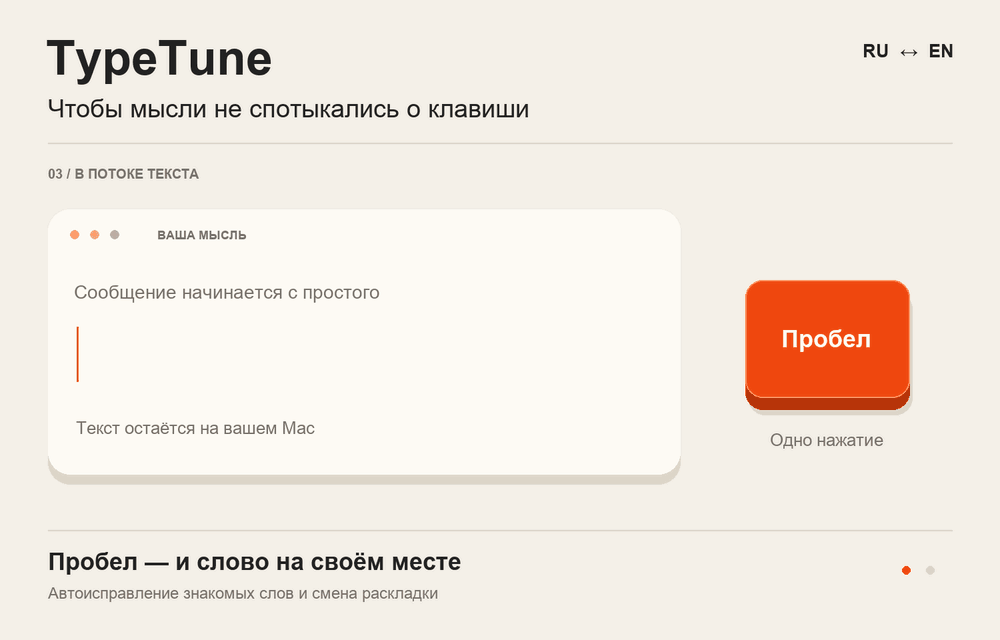

<p align="center">
  
</p>

<p align="center">
  <strong>Автоматическое исправление раскладки для macOS</strong><br>
  <sub>macOS 14+ · Apple Silicon · Русский ↔ English · Всё локально</sub>
</p>

<p align="center">
  <a href="#начать">Начать</a> · <a href="#подстроится-под-вас">Возможности</a> · <a href="#на-кончиках-пальцев">Горячие клавиши</a>
</p>

---

Вы уже на середине мысли. А раскладка осталась в прошлом предложении.

**TypeTune помогает не терять нить.** Исправляет знакомые слова после пробела и переключает язык. Если текст уже написан — выделите его и дважды нажмите Shift.

## Подстроится под вас

<table>
  <tr>
    <td width="50%" valign="top"><h3>Ваши слова. Ваши правила.</h3>Добавляйте свои замены и исключения. Выбирайте, в каких приложениях работают автоисправления.</td>
    <td width="50%" valign="top"><h3>Передумали? Одно сочетание.</h3><kbd>⌘</kbd> <kbd>⌥</kbd> <kbd>Z</kbd> вернёт исходное слово и сохранит его как исключение.</td>
  </tr>
  <tr>
    <td valign="top"><h3>Мелочи тоже считаются.</h3>Исправление опечаток, двух начальных заглавных букв и восстановление «ё».</td>
    <td valign="top"><h3>Рядом, когда нужно.</h3>Клик по флагу открывает компактные настройки с боковой панелью. Правый клик — пауза и выход. Окно следует светлой или тёмной теме macOS.</td>
  </tr>
</table>

## На кончиках пальцев

| Нажмите | Что произойдёт |
| :--- | :--- |
| <kbd>Shift</kbd> → <kbd>Shift</kbd> | Преобразовать слово или выделение |
| <kbd>⌘</kbd> <kbd>⌥</kbd> <kbd>Space</kbd> | То же самое, другим сочетанием |
| <kbd>⌘</kbd> <kbd>⌥</kbd> <kbd>Z</kbd> | Отменить замену и запомнить исключение |
| <kbd>Shift</kbd> (одно нажатие) | Переключить раскладку; включено по умолчанию, выключается в настройках |

<details>
<summary>Ещё два жеста — включаются в настройках</summary>

- **Одиночный Option** — преобразовать слово или выделение.
- **Левый + правый Shift** — поставить все автоисправления на паузу или возобновить их.

Пауза останавливает любые автоматические изменения: раскладку, опечатки, «ё», регистр и ваши замены. Ручное преобразование и отмена продолжают работать.

</details>

## Где работает

Во всех приложениях: TypeTune запоминает слово, которое вы набираете подряд, и исправляет его так же, как сделали бы вы, — стирает и набирает заново. Если приложение даёт прочитать текст поля через Универсальный доступ, перед правкой TypeTune сверяет, что там действительно набранное слово; если нет — правит по своей памяти, но только слово, набранное после пробела, Return или Tab. Клик мышью, стрелки и сочетания клавиш заставляют его забыть набранное, поэтому слово в середине чужого текста он не тронет.

Выделенный текст (Double Shift) читается через Универсальный доступ, а где это невозможно — копируется через буфер обмена; прежнее содержимое буфера обмена сразу возвращается. Многострочные выделения пока не преобразуются.

Пароли и защищённые поля пропускаются всегда. Приложение можно исключить в настройках. Если выключить «Исправлять во всех приложениях», TypeTune вернётся к прежнему строгому режиму: TextEdit, Chrome, Codex, а Terminal и Ghostty — через [интеграцию с zsh](docs/TERMINAL_INTEGRATION.md).

Поля, которые приложение не даёт прочитать (например, строка поиска Google в Chrome), правятся вслепую: стираются только набранные символы, включая первое слово после клика. После чтения интерфейса инструментом проверки Google и новая вкладка прошли по5/5; проверку после обычного перезапуска Chrome пользователь подтвердил отдельно («работает стабильно»).

> На Mac выполнена часть нативной матрицы ветки `universal-input`. Полная приёмка ещё не завершена; точная сборка, результаты и ограничения — в [STATUS](docs/STATUS.md).

## Начать

[Скачать релиз v0.1.8 для Apple Silicon](https://github.com/kartamyshev-dev/TypeTune/releases/tag/v0.1.8). Новый интерфейс «Редактор»: боковая панель, компактные формы и системная тема. [Релиз и ограничения](docs/RELEASE_0.1.8.md).

Приложение подписано без сертификата разработчика Apple и не нотаризовано. При первом запуске macOS его заблокирует: откройте «Системные настройки» → «Конфиденциальность и безопасность» и нажмите «Всё равно открыть» рядом с сообщением о TypeTune (на macOS 14 можно также открыть приложение через контекстное меню Finder → «Открыть»).

Mac с Apple Silicon, macOS 14 или новее и Swift 6 для сборки.

```sh
git clone https://github.com/kartamyshev-dev/TypeTune.git
cd TypeTune
./scripts/build.sh
```

1. Перенесите `dist/LayoutPilot.app` в «Программы» и переименуйте в `TypeTune.app`.
2. Откройте TypeTune. В системных настройках → «Конфиденциальность и безопасность» разрешите **Универсальный доступ** и **Мониторинг ввода**. Перезапустите приложение.
3. Добавьте в macOS английскую **ABC** или **US** и русскую **«Русская – ПК»** раскладки. Работа с Apple «Русская» пока не проверена. Завершите другие автоматические переключатели.

Откройте TextEdit. Выберите английскую раскладку. Наберите `ghbdtn` и пробел. Привет!

## Только вы и ваш Mac

Без аккаунта. Без облака. Без отправки текста на сервер.
Ваши настройки, замены и исключения остаются на компьютере.

<details>
<summary>Какие слова и поля обрабатываются</summary>

Автоисправление опирается на словарь примерно из 30 тысяч английских и 30 тысяч русских слов. Незнакомые слова, сочетания с цифрами и смешанными алфавитами остаются как есть. Изредка короткая латинская аббревиатура или имя совпадает с русским словом на тех же клавишах (`NBC` → «ТИС») — ⌘⌥Z вернёт его и запомнит исключение. Список приложений — в разделе «Где работает».

</details>

## Словарь и лицензии

Словарь (`lexicon.json`) — производная работа под [CC BY-SA 4.0](https://creativecommons.org/licenses/by-sa/4.0/): частоты [FrequencyWords](https://github.com/hermitdave/FrequencyWords) (Hermit Dave, OpenSubtitles 2018), проверка английских слов по [SCOWL](http://wordlist.aspell.net/) (Kevin Atkinson), русских — по словарю Hunspell ru_RU (А. И. Лебедев). Полные уведомления — в [LEXICON-NOTICE.txt](Sources/LayoutPilotCore/Resources/LEXICON-NOTICE.txt), сборка и проверка — в [docs/LEXICON.md](docs/LEXICON.md).

---

<p align="center"><em>Мысль ваша. Раскладку подхватим.</em></p>
